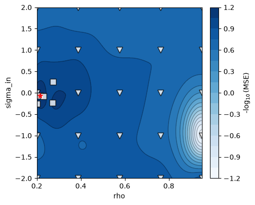
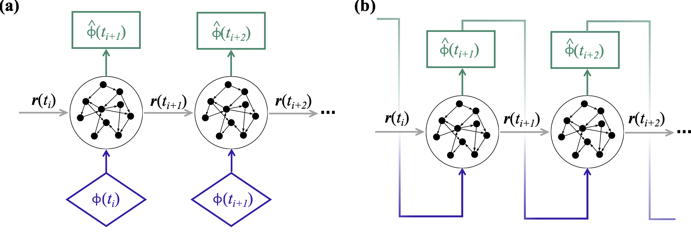

# Training and forecasting

One `EchoStateNetwork` holds three matrices: a fixed random input matrix
$\mathbf{W}_\mathrm{in}$, a fixed random reservoir matrix $\mathbf{W}$
(sparse, rescaled to unit spectral radius when generated), and the trained
readout $\mathbf{W}_\mathrm{out}$ — the only matrix that learning touches.

## The model

One `step(u, r)` advances the reservoir open loop and reads out the physical
state:

$$
\mathbf{r}_{n+1} = (1-\alpha)\,\mathbf{r}_n + \alpha \tanh\!\big(
\sigma_\mathrm{in} \mathbf{W}_\mathrm{in} [\tilde{\mathbf{u}}_n;\, b_\mathrm{in}]
+ \rho\, \mathbf{W} \mathbf{r}_n \big), \qquad
\mathbf{u}_{n+1} = \mathbf{W}_\mathrm{out}^\top [\mathbf{r}_{n+1};\, b_\mathrm{out}]
$$

where $\tilde{\mathbf{u}} = (\mathbf{u} - \texttt{shift}) / \texttt{norm}$ is
the shift-and-scale normalized input (set from the training data range by
default), $b_\mathrm{in}, b_\mathrm{out}$ are symmetry-breaking biases, and
$\alpha$ = `leak_rate` (the default $\alpha = 1$ is the plain tanh update; see
the [leaky-ESN tutorial](tutorials/03_leaky_esn.ipynb)).
The hyperparameters that matter are the effective spectral radius `rho`, the
input scaling `sigma_in`, and the Tikhonov regularization `tikh`; by default,
validation selects all three (below).

For a *parametric* ESN, `input_parameters` appends parameter columns to the
input, densely connected through $\mathbf{W}_\mathrm{in}$ — one reservoir
conditioned on a physical parameter
([tutorial 02](tutorials/02_parametric_esn.ipynb)).
With partial observability, `observed_idx` selects which components of the
full state are fed back as inputs.

For a spatially extended system, the *parallel* layout (`patch_size`, `halo`,
`periodic`) advances one reservoir per patch of neighbouring sites with the
same update, and the patches share the three matrices
([parallel echo state network](parallel.md)).

## Training

`train(train_data)` accepts a single trajectory `(Nt, N_dim)`, a batch of
segments `(L, Nt, N_dim)`, or a ragged list of segments of different lengths,
and runs four steps:

1. **Split** the data into washout (`N_wash` steps, inside `t_train`),
   training + validation (`t_train`, `t_val` — inferred from the data when
   omitted), and an optional held-out test tail (`t_test`). Gaussian noise
   (`noise`) is added to the training *inputs* only — targets stay clean — as
   regularization.
2. **Generate** $\mathbf{W}_\mathrm{in}$ and $\mathbf{W}$ from `seed`, if not
   already set, or when an option that defines them changed (see
   [training again](#training-again)).
3. **Select hyperparameters** by Bayesian optimization over
   `hyperparameters_to_optimize`, scoring each candidate with a
   [validation strategy](validation.md) — closed-loop error on folds carved
   from the training series. The search trace is kept in `bo_results`.

    With `'tikh'` in `hyperparameters_to_optimize`, every evaluation of the
    validation strategy selects the Tikhonov factor, `tikh`, from the grid
    `tikh_range`, so `tikh` is not a dimension of the Bayesian optimization.
    Without `'tikh'`, every evaluation keeps the fixed `tikh`, and `tikh_range`
    is left as it was. A search over `'tikh'` alone is therefore a grid
    search: `train` evaluates the strategy once at the fixed `rho`, `sigma_in`
    and `leak_rate`, without Bayesian optimization and without
    scikit-optimize. `bo_results` then holds that evaluation: one value in
    `func_vals`, `x = []` and `hp_names = []`.

    A parametric network also searches the normalization of its parameters.
    With `optimize_parameter_normalization`, which is on by default with
    `input_parameters`, `train` adds the shift and the scale of every
    parameter column (`param_shift_i`, `param_norm_i`) to the search, which is
    then a Bayesian optimization with the budget `N_func_evals`, also for
    `hyperparameters_to_optimize=[]` or `['tikh']`. An empty
    `hyperparameters_to_optimize` therefore skips the search, and leaves
    `bo_results` None, only without `input_parameters` or with
    `optimize_parameter_normalization=False`.

    

    *Validation-error landscape over `(rho, sigma_in)` from
    [tutorial 01](tutorials/01_echo_state_network.ipynb):
    markers are the evaluated points (initial grid + gp-hedge acquisitions),
    the star the selected optimum. `plot_training=True` produces this figure.*
4. **Solve** the ridge regression for $\mathbf{W}_\mathrm{out}$ on the full
   train + validation data with the selected `tikh`.

The keywords of `train` set attributes of the network before these steps, e.g.
`esn.train(y, rho_range=(0.5, 1.0))`. A keyword that is not an option, e.g. a
misspelt name, a method or a read-only property, is ignored, and one warning
per call names it, also with `n_seeds > 1` and with independent patches. A call
of `train` that raises, or that is interrupted, leaves the network as it was,
with the options and the matrices that it had before the call.

`training_summary()` returns the realized split, folds, and selected
hyperparameters of the last call; with `echostatenetwork.set_verbose()`, `train`
also logs it, with the table of the hyperparameter search.

### Training again

A trained network is not trained again: a second `train` call warns and leaves
the network unchanged, unless it passes `force=True`. A copy of a trained
network (`esn.copy()`) and a network loaded with its matrices (`from_arrays`,
`pickle`) are trained, so that training them on other data also needs
`force=True`. With `force=True`, `train` keeps

- the reservoir ($\mathbf{W}_\mathrm{in}$, $\mathbf{W}$) while `N_units`,
  `connect`, `Win_type`, the number of inputs (`observed_idx`) and of parameter
  columns (`input_parameters`), `param_in_reservoir`, `patch_size` and `halo`
  are unchanged, as keywords of `train` or as attributes, whatever the seed
  given to `train`;
- a `t_train` or `t_val` that was given, to the constructor, to `train` or as
  an attribute;

and computes again

- the hyperparameter search and $\mathbf{W}_\mathrm{out}$;
- the reservoir, when one of the options above changes, from the seed given to
  `train`, else from the seed of the reservoir; a diagnostic message names the
  option;
- a `t_train` or `t_val` that the previous call inferred, from the new data, so
  that the same data give the same split, and shorter data still train;
- `dt_ESN = dt * upsample` from a new `upsample`, with the time step of the
  data, `dt`, unchanged; `t_train` and `t_val` remain times.

#### Details and edge cases

- **The seed.** A seed alone does not replace the reservoir:
  `train(seed=s, force=True)` without a changed option keeps it, and warns
  that `seed` is ignored unless `s` is the seed of the reservoir. A new network
  trained with `train(seed=s)` draws the reservoir of `s`, and
  `train(seed=s, n_seeds=m, force=True)` trains the realizations of the seeds
  `s, s+1, ..., s+m-1`, each with its own reservoir, and keeps the best one
  (see [seeded ensembles](#seeded-ensembles)). A new reservoir comes from a
  new generator: it is the reservoir that a new network with the same options
  draws with `train(seed=...)`. The first call of `train` draws the reservoir
  from the generator `rng` of the attribute `seed`, after the noise on the
  inputs, so no seed reproduces this reservoir: a reservoir that `train` draws
  again then comes from the attribute `seed`, and an option changed and then
  changed back does not restore the reservoir of the first call. Setting the
  attribute `seed`, e.g. `esn.seed = 7`, starts the noise on the inputs from a
  new generator and keeps the reservoir.
- **Matrices set by hand and networks pickled by echostatenetwork 0.2.3 or
  earlier.** `train` treats a reservoir set by hand (`W`, `Win`,
  `from_arrays`), or held by a 0.2.3 network, as a reservoir drawn with the
  options that the network has at the start of the call: an option that the
  call changes draws a new reservoir from the attribute `seed`, so that
  networks that share one reservoir draw the same new one. When only one
  matrix fits the options, e.g. after `esn.N_units = 20; esn.W = W20`, `train`
  keeps that matrix and draws the other one alone.
- **The split of a network pickled by echostatenetwork 0.2.3**, which has no
  record of what it inferred. On one series, `train` takes `t_train` and
  `t_val` as inferred when they are the split that it infers (the training and
  validation steps fill 80% of the series, and `t_val` is 20% of these) and
  `split_summary` says that `t_val` was inferred. For a network trained with
  `n_seeds > 1` (it holds `seed_scores`), whose summary may say that an
  inferred `t_val` was given, the split alone decides, so that a given split
  equal to the inferred one is inferred again. Otherwise, `train` infers
  `t_val` again when the summary says so, and keeps `t_train`. To keep a
  split, pass `t_train` and `t_val` to `train`.
- **Attributes set to an inferred value.** An attribute set to the value that
  the previous call inferred, e.g. `esn.t_val = esn.t_val`, cannot be told
  from the inferred value and is inferred again: to keep it, pass it to
  `train`, e.g. `esn.train(y, t_val=esn.t_val, force=True)`.
- **The normalization of the parameters.** `train` adds again to
  `hyperparameters_to_optimize` the names `param_shift_i` and `param_norm_i`
  that the previous call added, only while the network has parameters and
  `optimize_parameter_normalization`, unless the list was set since. Removing
  the parameters (`input_parameters=None`) or setting
  `optimize_parameter_normalization=False` therefore removes them from the
  search. The ranges `param_shift_range` and `param_norm_range` that the first
  call sized from the parameters are kept.
- **The time step of the data.** `dt` is a parameter of the constructor, not
  an option of the network: `train(dt=0.5, force=True)` ignores it, with a
  warning that suggests `dt_ESN`. To change the time step of the data, pass
  the time step of the network, `dt_ESN = dt * upsample`, e.g.
  `esn.train(y, dt_ESN=0.5 * esn.upsample, force=True)` for `dt = 0.5`, or set
  the attribute `esn.dt_ESN`.
- **The readout.** `readout_input` changes $\mathbf{W}_\mathrm{out}$ only.
- **The noise on the inputs.** Training a single network again on the same
  data with the same options does not reproduce it: the noise on the inputs
  continues the generator `rng`, so the selected hyperparameters and
  $\mathbf{W}_\mathrm{out}$ may change. With `n_seeds > 1`, every realization
  draws its noise from its own seed, and training again reproduces the
  realizations.
- **Independent patches** (`shared=False`). The network of every patch has
  its own seed, `patches[p].seed`, which `train` spawns from the seed of the
  parallel network when it builds the networks of the patches. The network of
  a patch follows the rules above: an option that defines its reservoir draws
  a new one from the seed of the patch, which a new single network with the
  options of the patch reproduces with `train(seed=patches[p].seed)`, and a
  new parallel network does not. `train` builds the networks again, with seeds
  spawned from the seed given to `train`, else from the attribute `seed`, only
  when `patch_size` or `halo` changes. Otherwise, a seed given to `train` is
  ignored, with a warning: the networks keep their seeds, and their reservoirs
  unless an option changes them. Setting the attribute `seed` of the parallel
  network therefore changes neither the seeds nor the noise of the patches
  until `train` builds the networks again. The networks of the patches take
  the split and the time step of the parallel network. An option changed on
  the parallel network, as a keyword of `train` or as an attribute (e.g.
  `esn.N_units = 10`), reaches the network of every patch; the other options
  of a patch, e.g. the `rho` that its own search selected, are kept.

### Seeded ensembles

The reservoir is a random draw, so `train(n_seeds=m)` trains `m` realizations
(seeds `base, base+1, ...`) in parallel processes, keeps the network with the
best validation score in place, and stores every score in `seed_scores` —
selection by validation score consistently lands in the ensemble's best half
on test error (see the
[validation strategies](validation.md#ensembles-of-reservoir-seeds) page).
The score of a realization is the minimum of its search (`bo_results['fun']`)
or, without a search, one evaluation of the validation strategy at the fixed
hyperparameters of the realization, `tikh` included. The first seed, `base`, is
the `seed` given to `train`. Without it, `base` is the first seed of the
previous call with `n_seeds > 1` while the attribute `seed` is one of the seeds
of that call, as after it (the kept seed), so that training again with
`force=True` on the same data and options selects the same realization;
otherwise, e.g. on the first call, `base` is the attribute `seed`. A call with
`n_seeds = 1` leaves `seed_scores`, which then hold the scores of the last call
with `n_seeds > 1`. A warning raised while the realizations train, e.g.
when fewer validation folds than `N_folds` fit, appears once, at the line that
calls `train`, and follows the warnings filters of the calling process. That is
also where the warning points when it comes from code of the user that the
package calls back, e.g. a validation strategy that calls `validation.WFV`; a
single network points at that code instead.

## Forecasting

The ESN runs in two modes:



*(a) open loop: the reservoir is driven by data $\phi(t_i)$ and its readouts
$\hat{\phi}(t_{i+1})$ are one-step-ahead predictions; (b) closed loop: each
prediction is fed back as the next input and the network runs autonomously.*

- **Open loop**: `step()` is fed observed data; used for
  training and for *washout* — driving the reservoir from
  $\mathbf{r}_0 = \mathbf{0}$ through a short window of true history so it
  synchronizes with the physical state before a forecast.
- **Closed loop**: each prediction is fed back as the next input
  (`outputs_to_inputs` selects the observed components and re-appends the
  parameter columns); the model runs autonomously.

```python
r = np.zeros((esn.N_units, 1))
u = np.zeros((esn.N_dim, 1))
for u_in in wash:                      # open-loop washout on true history
    u, r = esn.step(u_in[:, None], r)

forecast = []
for _ in range(n_steps):               # closed-loop forecast
    u, r = esn.step(esn.outputs_to_inputs(u), r)
    forecast.append(u[:, 0])
```

Alignment: the washout's last output is the one-step-ahead prediction of the
frame *after* `wash`, so closed-loop prediction `i` corresponds to data row
`len(wash) + 1 + i`.

`run_test()` packages this — open-loop washout, closed-loop forecast, error
against truth — over the held-out test tail, with plots. For a fair error
metric across components use `compute_nMAE(Y_true, Y_pred, norm=...)`, the
range-normalized mean absolute error used throughout training and validation.

See the
[EchoStateNetwork tutorial](tutorials/01_echo_state_network.ipynb)
for the full workflow on Lorenz 63, and the
[API reference](api/esn.md) for every attribute and method.
